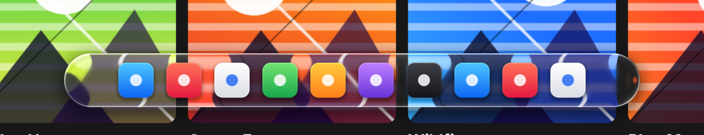
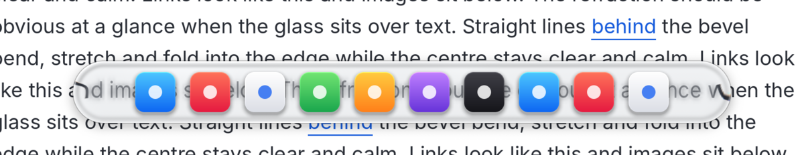
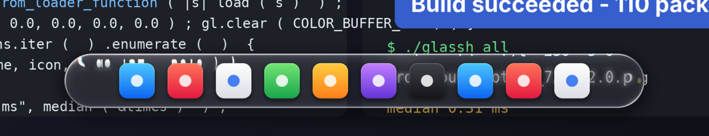
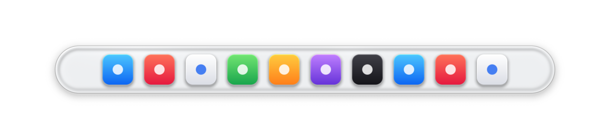

<div align="center">



<br>


[](LICENSE)


**A floating dock for [Hyprland](https://hyprland.org) with macOS-style magnification, auto-hide and a
"Liquid Glass" material that really refracts what is behind it.**
One small Rust binary. No GTK, no Qt, no toolkit: it draws itself with OpenGL ES.

</div>

---

## Highlights

- **Liquid Glass.** A fragment shader bends a snapshot of the backdrop through a thick bevelled
  capsule, splits colours slightly (chromatic dispersion), frosts the interior, adds key and counter
  specular lights and a soft shadow. The tint adapts to bright or dark backgrounds, so the dock
  stays readable over a white page and still looks like glass over a wallpaper.
- **Magnification** like the macOS dock: a cosine bell of up to 1.78x, the capsule widens with the
  icons, a name pill follows the pointer, apps bounce while they launch.
- **Auto-hide** with a thin hot zone at the bottom of the screen. While the dock is hidden the process does
  not redraw at all: **0 % CPU** when idle.
- **Multi-monitor.** One surface per output inside a single process, hot-plug aware, fractional
  scaling aware (`wp-fractional-scale` + `wp-viewporter`), sharp at 1.0x, 1.6x and everything in between.
- **Drag to reorder.** Grab a pinned icon and move it: the others glide aside to make room, and the
  new order is saved when you drop it.
- **Recommended apps**, like the macOS Dock: a short section after the divider with the apps you
  used recently or often that are closed and not pinned. One click launches them.
- **Settings app.** A native-feeling liquid-glass window (`glassdock settings`, also listed in your
  app launcher) with a toggle for the recommended apps, the magnification and its zoom level.
- **Real window awareness.** Running apps get an indicator, clicking focuses or launches, the
  right-click menu offers new window, desktop actions, minimize, close, reorder and pin or unpin.
- **Light on resources.** Roughly 0.2 ms of CPU per animated frame and about 80 MB resident for three
  monitors. A discrete NVIDIA GPU is never woken up: EGL is pinned to Mesa and the integrated GPU.
- **Self-contained.** Icons and text are rasterised by the dock itself. Pinned apps live in one JSON
  file. A launcher script restarts the dock if it ever crashes.

## Demo

### Magnification



Icons under the pointer grow along a smooth cosine bell. The pointer is mapped back onto the resting
layout, so the bell does not jitter while the icons move under it.

### Auto-hide



The dock is a transparent surface whose *input region* is cut down to the visible dock (or to a
4 px strip while hidden), so it never steals clicks from windows underneath.

### Drag to reorder, and recommended apps


Only pinned apps can be dragged (running apps that are not pinned can be pinned from their menu). The
recommended apps are never pinned: they come and go with your usage.

### The glass



The same dock over four different backdrops (rendered by the real shader, no mock-ups):

<table>
  <tr>
    <td></td>
    <td></td>
  </tr>
  <tr>
    <td></td>
    <td></td>
  </tr>
</table>

### How a frame is made



More detail in [docs/ARCHITECTURE.md](docs/ARCHITECTURE.md).

## Requirements

| What | Why |
| --- | --- |
| **Hyprland** (developed on 0.53) | `wlr-layer-shell`, `wlr-screencopy` and the IPC sockets. Other wlroots compositors may work, but are untested. |
| **Rust** (stable, 2021 edition) | To build. |
| **EGL + OpenGL ES 3.0** (`libEGL`, `libwayland-egl`, Mesa or a vendor driver) | Rendering. |
| `rofi` *(optional)* | The `+` button uses it to pick an app to pin. |
| `gio` from GLib *(optional but recommended)* | Launches `.desktop` entries. |
| `socat` *(optional)* | Used by `glassdockctl`; Python 3 is the fallback. |

GlassDock needs `wlr-screencopy`, which GNOME and KDE do not offer, so it is a Hyprland (and
wlroots) tool by design.

## Install

```bash
git clone https://github.com/OWNER/glassdock.git
cd glassdock
./scripts/install.sh
```

That builds a release binary and installs it into `~/.local` (binaries in `~/.local/bin`, examples in
`~/.local/share/glassdock`). It does **not** touch your Hyprland configuration.

Then either start it by hand from inside your Hyprland session:

```bash
glassdock-launch &
```

or let Hyprland start it. Add this line to `~/.config/hypr/hyprland.conf`:

```ini
exec-once = glassdock-launch
```

Prefer to let the installer do it? `./scripts/install.sh --autostart` appends that line (and makes a
timestamped backup of your config first).

Other options: `--prefix /usr/local`, `--no-build`, `--hypr-conf <file>`. To remove everything:
`./scripts/uninstall.sh` (add `--purge` to also delete your settings, pinned apps and usage history).

### Try it without installing

```bash
cargo build --release
GLASSDOCK_BIN=target/release/glassdock scripts/glassdock-launch
```

## Usage

| Action | Result |
| --- | --- |
| Push the pointer against the bottom edge, where the dock sits | The dock slides in. It hides 0.45 s after the pointer leaves. |
| Left-click an icon | Focus the app's window (cycling if it has several) or launch it. |
| Drag a pinned icon | Reorder the dock. Drop it where you want it; the order is saved. |
| Right-click an icon | Menu: new window, desktop actions, minimize or close (one or all windows), move left or right, pin or unpin, dock settings. |
| Right-click a recommended icon | Keep it in the dock, or remove it from the recommendations. |
| Click `+` | Pick an installed app to pin (needs `rofi`). |
| Right-click `+` | Open the dock settings. |

Pinned apps are stored in `~/.config/glassdock/pinned.json`. The first run seeds a generic set of
apps that are actually installed on your system; edit the file or use the menu to change it.
See [`config/pinned.example.json`](config/pinned.example.json).

### Recommended apps

After a divider at the right end of the dock, GlassDock suggests up to three apps (up to five in the
settings) that are **closed, not pinned, and that you used recently or often**. Every window that
opens gives its app a point, and points lose half of their value every week, so an app you opened an
hour ago and an app you open every day both rank high. Only desktop-entry ids and timestamps are
stored, in `~/.local/state/glassdock/usage.json`; nothing leaves your machine.

The very first time, if GNOME Shell's app history exists on the machine
(`~/.local/share/gnome-shell/application_state`), GlassDock starts from it so the section is not
empty. It is read once and never written. Turn the section off in the settings, remove one app with
its right-click menu, or clear the history in the settings window.

### Settings

Right-click the `+` button (or any icon) and choose **Dock settings...**, run `glassdock settings`, or
open "GlassDock Settings" from your launcher. Changes apply immediately.

<p align="center"></p>

| Setting | Default | |
| --- | --- | --- |
| Hide automatically | on | The dock slides in at the bottom edge. Off: it stays visible and windows make room for it. |
| Live glass | on | Hyprland blurs what is behind the dock every frame, so moving content shows through. Needs the `glassdock-live` layer rule from [`config/hyprland.conf.example`](config/hyprland.conf.example). Off: the lensed refraction of a snapshot taken when the dock appears. |
| Outline follows system colour | off | The glass edge takes the desktop accent: Hyprland's `general:col.active_border` (first and last colour, 45deg gradient), so themes and wallpaper colour sync show on the dock. Re-read on reveal, on config reload and on `glassdockctl color`; fades in 250 ms. Also `"outline_system": true` in `settings.json`. |
| Magnification | on | Icons grow under the pointer. |
| Zoom level | 1.78x | Peak size of the magnification (1.25x to 2x). |
| Show recommended apps | on | The section described above. |
| Number of recommended apps | 3 | 1 to 5. |

**Outline colour, how it works.** With the option on, the dock reads the active window border of
Hyprland (`hyprctl getoption general:col.active_border`: the first and second colour of the
gradient, any alpha is ignored) through its own IPC at start, when the option changes, each time the
dock is revealed, on `configreloaded`, and on `glassdockctl color` (the desktop's theme script calls
it after changing the colours, never waiting for it). The ring is tinted along a 45deg gradient over
the panel (first colour bottom-left, second top-right); it replaces part of the white rim light
instead of adding a neon line, is a little stronger on the lit sides, and a colour that is too dark
is brightened (hue kept) so it stays visible on dark and bright backdrops. Changes fade over 250 ms;
nothing polls and nothing redraws while the dock rests.

They live in `~/.config/glassdock/settings.json`, which you can also edit by hand: the dock notices
the change within two seconds (or run `glassdockctl reload`).

### Minimizing

Hyprland has no "minimize". The menu entry (and the example binds in
[`config/hyprland.conf.example`](config/hyprland.conf.example)) move a window to a special workspace;
clicking its icon in the dock brings it back.

### Controlling a running dock

```bash
glassdockctl reveal eDP-1        # show the dock on one monitor for 4 s
glassdockctl hide all
glassdockctl refresh             # re-read windows and desktop entries
glassdockctl color               # re-read the system accent for the outline option
glassdockctl dump | python3 -m json.tool
glassdockctl quit                # stop the dock (the launcher will not restart it)
```

## Configuration

Behaviour is set in the settings window (stored in `settings.json`, see above). Paths and a few
low-level options are environment variables (set them with `env = NAME,value` in `hyprland.conf`),
and the pinned apps live in a JSON file.

| Variable | Default | Meaning |
| --- | --- | --- |
| `GLASSDOCK_OUTPUTS` | all monitors | Comma-separated monitor names to show the dock on, e.g. `eDP-1,DP-1`. |
| `GLASSDOCK_PINNED` | `~/.config/glassdock/pinned.json` | Pinned-apps file. |
| `GLASSDOCK_SETTINGS` | `~/.config/glassdock/settings.json` | Settings file. |
| `GLASSDOCK_USAGE` | `~/.local/state/glassdock/usage.json` | App usage history (recommended apps). |
| `GLASSDOCK_NAMESPACE` | `glassdock` | Layer-shell namespace, for compositor rules. |
| `GLASSDOCK_SOCKET` | `$XDG_RUNTIME_DIR/glassdock.sock` | Control socket (`glassdockctl`, the settings window). |
| `GLASSDOCK_LANG` | from your locale | `en` or `es`, language of the dock's own menus. |
| `GLASSDOCK_DEBUG` | unset | Log input and capture events to stderr (or `journalctl -t glassdock`). |
| `GLASSDOCK_BIN` | next to the launcher, then `$PATH` | Binary used by `glassdock-launch`. |

The full reference, including the Hyprland snippets for monitor layout, is in
[docs/CONFIGURATION.md](docs/CONFIGURATION.md). Common problems (a white cursor over the dock, a dark
halo, the dock missing in fullscreen) are covered in [docs/TROUBLESHOOTING.md](docs/TROUBLESHOOTING.md).

> **Important:** do not add a Hyprland `layerrule = blur` for the `glassdock` namespace. The dock
> already refracts its own backdrop; compositor blur would paint a dark halo around it.

## Performance

Measured on an Intel Iris Xe laptop (hybrid Intel + NVIDIA, Hyprland 0.53, three monitors, one of them
fractionally scaled):

| | |
| --- | --- |
| Idle (dock hidden) | **0 % CPU**, no frame callbacks |
| Animating | ~0.22 ms CPU per frame |
| Glass shader | ~0.12 to 0.4 ms GPU per frame |
| Memory | ~80 MB resident for three monitors |
| Discrete GPU | stays asleep |

## Limitations

Being honest about what this is:

- The glass shows a **snapshot** of what is behind the dock, captured while the dock is hidden. If a
  video plays behind the dock while it is open, the glass will not follow it.
- It needs `wlr-screencopy`, so it does not run on GNOME or KDE.
- No keyboard navigation yet. Dragging reorders pinned apps only (it cannot pin an app by dropping
  it on the dock yet).
- The recommended apps need some usage before they appear (except when GNOME's history can seed them).
- The `+` picker depends on `rofi`.
- It has been tested by its author on one machine (Ubuntu with Hyprland 0.53). Reports from other
  setups are very welcome.

## Roadmap

- [ ] Drop an app or window on the dock to pin it, and drag an icon out to unpin
- [ ] Keyboard navigation and a toggle keybind
- [ ] Optional vertical (left and right) placement
- [ ] A TOML config file for sizes, zoom and delays
- [ ] Packaging: AUR, `.deb`, Nix flake

## Development

```bash
cargo test                 # unit tests (layout, model, i18n, rasteriser)
cargo build --release
GLASSDOCK_DEBUG=1 target/release/glassdock
glassdockctl shader shaders/   # hot-reload glass.frag while the dock is running
```

See [CONTRIBUTING.md](CONTRIBUTING.md) for the workflow and [CHANGELOG.md](CHANGELOG.md) for the
history.

## Acknowledgements

- Apple's Liquid Glass and the macOS Dock are the visual inspiration. GlassDock is an independent
  project and is not affiliated with Apple.
- Built on the excellent Rust Wayland ecosystem: [smithay-client-toolkit](https://github.com/Smithay/client-toolkit),
  [wayland-rs](https://github.com/Smithay/wayland-rs), [glow](https://github.com/grovesNL/glow),
  [resvg](https://github.com/linebender/resvg) and [Hyprland](https://hyprland.org).

## License

[MIT](LICENSE)
