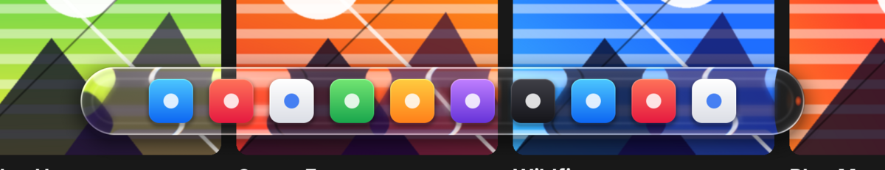
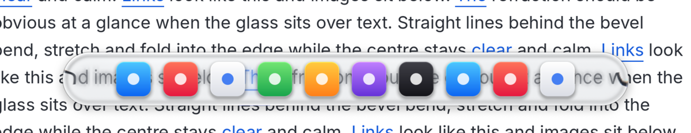
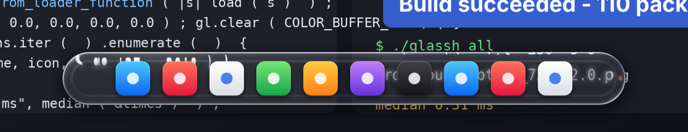
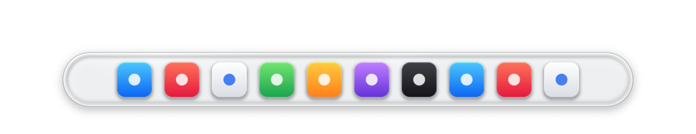

<div align="center">



<br>


[](LICENSE)


**A floating dock for [Hyprland](https://hyprland.org) with macOS-style magnification, auto-hide and a
"Liquid Glass" material that really refracts what is behind it.**
One small Rust binary. No GTK, no Qt, no toolkit: it draws itself with OpenGL ES.

</div>

---

## Highlights

- **Liquid Glass.** A fragment shader bends a snapshot of the backdrop through a thick bevelled
  capsule, splits colours slightly (chromatic dispersion), frosts the interior, adds key and counter
  specular lights and a soft shadow. The tint adapts to bright or dark backgrounds, so the dock
  stays readable over a white page and still looks like glass over a wallpaper.
- **Magnification** like the macOS dock: a cosine bell of up to 1.78x, the capsule widens with the
  icons, a name pill follows the pointer, apps bounce while they launch.
- **Auto-hide** with a thin hot zone at the bottom of the screen. While the dock is hidden the process does
  not redraw at all: **0 % CPU** when idle.
- **Multi-monitor.** One surface per output inside a single process, hot-plug aware, fractional
  scaling aware (`wp-fractional-scale` + `wp-viewporter`), sharp at 1.0x, 1.6x and everything in between.
- **Real window awareness.** Running apps get an indicator, clicking focuses or launches, the
  right-click menu offers new window, desktop actions, minimize, close, reorder and pin or unpin.
- **Light on resources.** Roughly 0.2 ms of CPU per animated frame and about 80 MB resident for three
  monitors. A discrete NVIDIA GPU is never woken up: EGL is pinned to Mesa and the integrated GPU.
- **Self-contained.** Icons and text are rasterised by the dock itself. Pinned apps live in one JSON
  file. A launcher script restarts the dock if it ever crashes.

## Demo

### Magnification



Icons under the pointer grow along a smooth cosine bell. The pointer is mapped back onto the resting
layout, so the bell does not jitter while the icons move under it.

### Auto-hide



The dock is a transparent surface whose *input region* is cut down to the visible dock (or to a
4 px strip while hidden), so it never steals clicks from windows underneath.

### The glass



The same dock over four different backdrops (rendered by the real shader, no mock-ups):

<table>
  <tr>
    <td></td>
    <td></td>
  </tr>
  <tr>
    <td></td>
    <td></td>
  </tr>
</table>

### How a frame is made



More detail in [docs/ARCHITECTURE.md](docs/ARCHITECTURE.md).

## Requirements

| What | Why |
| --- | --- |
| **Hyprland** (developed on 0.53) | `wlr-layer-shell`, `wlr-screencopy` and the IPC sockets. Other wlroots compositors may work, but are untested. |
| **Rust** (stable, 2021 edition) | To build. |
| **EGL + OpenGL ES 3.0** (`libEGL`, `libwayland-egl`, Mesa or a vendor driver) | Rendering. |
| `rofi` *(optional)* | The `+` button uses it to pick an app to pin. |
| `gio` from GLib *(optional but recommended)* | Launches `.desktop` entries. |
| `socat` *(optional)* | Used by `glassdockctl`; Python 3 is the fallback. |

GlassDock needs `wlr-screencopy`, which GNOME and KDE do not offer, so it is a Hyprland (and
wlroots) tool by design.

## Install

```bash
git clone https://github.com/OWNER/glassdock.git
cd glassdock
./scripts/install.sh
```

That builds a release binary and installs it into `~/.local` (binaries in `~/.local/bin`, examples in
`~/.local/share/glassdock`). It does **not** touch your Hyprland configuration.

Then either start it by hand from inside your Hyprland session:

```bash
glassdock-launch &
```

or let Hyprland start it. Add this line to `~/.config/hypr/hyprland.conf`:

```ini
exec-once = glassdock-launch
```

Prefer to let the installer do it? `./scripts/install.sh --autostart` appends that line (and makes a
timestamped backup of your config first).

Other options: `--prefix /usr/local`, `--no-build`, `--hypr-conf <file>`. To remove everything:
`./scripts/uninstall.sh` (add `--purge` to also delete your pinned apps).

### Try it without installing

```bash
cargo build --release
GLASSDOCK_BIN=target/release/glassdock scripts/glassdock-launch
```

## Usage

| Action | Result |
| --- | --- |
| Push the pointer against the bottom edge, where the dock sits | The dock slides in. It hides 0.45 s after the pointer leaves. |
| Left-click an icon | Focus the app's window (cycling if it has several) or launch it. |
| Right-click an icon | Menu: new window, desktop actions, minimize or close (one or all windows), move left or right, pin or unpin. |
| Click `+` | Pick an installed app to pin (needs `rofi`). |

Pinned apps are stored in `~/.config/glassdock/pinned.json`. The first run seeds a generic set of
apps that are actually installed on your system; edit the file or use the menu to change it.
See [`config/pinned.example.json`](config/pinned.example.json).

### Minimizing

Hyprland has no "minimize". The menu entry (and the example binds in
[`config/hyprland.conf.example`](config/hyprland.conf.example)) move a window to a special workspace;
clicking its icon in the dock brings it back.

### Controlling a running dock

```bash
glassdockctl reveal eDP-1        # show the dock on one monitor for 4 s
glassdockctl hide all
glassdockctl refresh             # re-read windows and desktop entries
glassdockctl dump | python3 -m json.tool
glassdockctl quit                # stop the dock (the launcher will not restart it)
```

## Configuration

GlassDock has no config file for behaviour; everything is an environment variable (set it with
`env = NAME,value` in `hyprland.conf`) plus the pinned-apps JSON.

| Variable | Default | Meaning |
| --- | --- | --- |
| `GLASSDOCK_OUTPUTS` | all monitors | Comma-separated monitor names to show the dock on, e.g. `eDP-1,DP-1`. |
| `GLASSDOCK_PINNED` | `~/.config/glassdock/pinned.json` | Pinned-apps file. |
| `GLASSDOCK_LANG` | from your locale | `en` or `es`, language of the dock's own menus. |
| `GLASSDOCK_DEBUG` | unset | Log input and capture events to stderr (or `journalctl -t glassdock`). |
| `GLASSDOCK_BIN` | next to the launcher, then `$PATH` | Binary used by `glassdock-launch`. |

The full reference, including the Hyprland snippets for monitor layout, is in
[docs/CONFIGURATION.md](docs/CONFIGURATION.md). Common problems (a white cursor over the dock, a dark
halo, the dock missing in fullscreen) are covered in [docs/TROUBLESHOOTING.md](docs/TROUBLESHOOTING.md).

> **Important:** do not add a Hyprland `layerrule = blur` for the `glassdock` namespace. The dock
> already refracts its own backdrop; compositor blur would paint a dark halo around it.

## Performance

Measured on an Intel Iris Xe laptop (hybrid Intel + NVIDIA, Hyprland 0.53, three monitors, one of them
fractionally scaled):

| | |
| --- | --- |
| Idle (dock hidden) | **0 % CPU**, no frame callbacks |
| Animating | ~0.22 ms CPU per frame |
| Glass shader | ~0.12 to 0.4 ms GPU per frame |
| Memory | ~80 MB resident for three monitors |
| Discrete GPU | stays asleep |

## Limitations

Being honest about what this is:

- The glass shows a **snapshot** of what is behind the dock, captured while the dock is hidden. If a
  video plays behind the dock while it is open, the glass will not follow it.
- It needs `wlr-screencopy`, so it does not run on GNOME or KDE.
- No keyboard navigation and no drag-to-reorder yet (use "Move left / right" in the menu).
- The `+` picker depends on `rofi`.
- It has been tested by its author on one machine (Ubuntu with Hyprland 0.53). Reports from other
  setups are very welcome.

## Roadmap

- [ ] Drag to reorder and drag a window to pin
- [ ] Keyboard navigation and a toggle keybind
- [ ] Optional vertical (left and right) placement
- [ ] A TOML config file for sizes, zoom and delays
- [ ] Packaging: AUR, `.deb`, Nix flake

## Development

```bash
cargo test                 # unit tests (layout, model, i18n, rasteriser)
cargo build --release
GLASSDOCK_DEBUG=1 target/release/glassdock
glassdockctl shader shaders/   # hot-reload glass.frag while the dock is running
```

See [CONTRIBUTING.md](CONTRIBUTING.md) for the workflow and [CHANGELOG.md](CHANGELOG.md) for the
history.

## Acknowledgements

- Apple's Liquid Glass and the macOS Dock are the visual inspiration. GlassDock is an independent
  project and is not affiliated with Apple.
- Built on the excellent Rust Wayland ecosystem: [smithay-client-toolkit](https://github.com/Smithay/client-toolkit),
  [wayland-rs](https://github.com/Smithay/wayland-rs), [glow](https://github.com/grovesNL/glow),
  [resvg](https://github.com/linebender/resvg) and [Hyprland](https://hyprland.org).

## License

[MIT](LICENSE)
