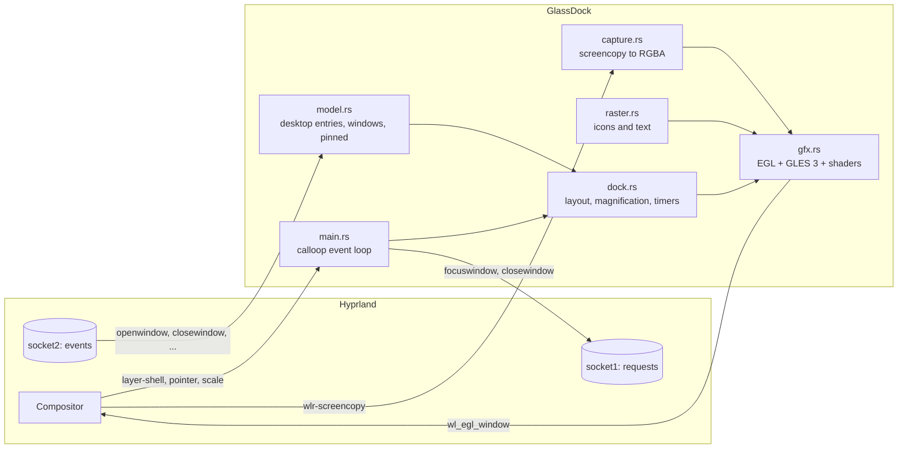

# Architecture

GlassDock is a single-process, single-threaded Wayland client. It talks to the compositor with
plain Wayland protocols, to Hyprland through its IPC sockets, and draws everything itself with
OpenGL ES 3 through EGL.



## Modules

| File | Responsibility |
| --- | --- |
| `src/main.rs` | The `App`: a [calloop](https://github.com/Smithay/calloop) event loop that owns the Wayland connection, one `View` per output, the context menu, the control socket and the frame-callback driven redraw. |
| `src/dock.rs` | Pure layout and animation maths, with no Wayland or GL in it, which is why it has unit tests. Slot positions, the magnification bell, exponential smoothing, reveal and hide timers, hit testing and the input region. |
| `src/gfx.rs` | EGL context shared by every output, GLSL programs (`shape`, `tex`, `glass`), textures, and hot-swapping of the glass shader. |
| `src/capture.rs` | Memfd-backed `wl_shm` buffers for `wlr-screencopy`, pixel-format conversion to RGBA, mean luminance. |
| `src/raster.rs` | CPU rasterisation (resvg, tiny-skia, skrifa) of SVG and PNG icons and of text for labels and menus. Results are uploaded once as textures. |
| `src/model.rs` | The desktop model: `.desktop` entries, icon theme lookup, the Hyprland IPC client (`j/clients`, event stream), the pinned-apps file and its first-run seed. |
| `src/i18n.rs` | The handful of UI strings, English and Spanish. |
| `shaders/` | `glass.vert` and `glass.frag`, embedded into the binary and also loadable at runtime for development. |

## One surface per monitor

Each output gets a transparent `wlr-layer-shell` surface on the `top` layer, anchored to the bottom
edge, with an exclusive zone of `-1` so windows are never resized. Its size is fixed, big enough for
the fully magnified dock plus the shadow. Nothing is ever resized while animating.

### The input-region trick

A fixed, mostly transparent surface would swallow clicks meant for the windows beneath it. GlassDock
therefore calls `wl_surface.set_input_region` with only the rectangle the dock currently occupies:

- hidden: a **4 px tall hot zone** at the bottom edge, centred under the dock's resting position and a little wider than it,
- visible: the dock capsule, grown by the magnification overshoot,
- menu open: the dock plus the menu.

When the pointer enters the hot zone the dock reveals; when it leaves for longer than
`HIDE_DELAY` (450 ms) it hides again.

## Frame loop

GlassDock never draws on a timer. It asks for a `wl_surface.frame` callback only while something is
animating (a spring has not settled, a bounce is running, the reveal is in progress). The callback
steps `Layout::step(dt, ...)`, draws, swaps buffers and, if the animation is not finished, requests
the next callback. When everything has settled no callback is pending and the process sleeps in
`epoll`: **0 % CPU when idle**.

Smoothing is frame-rate independent: `value += (target - value) * (1 - exp(-dt * k))` with
`K_SCALE = 24`, `K_REVEAL = 13`, `K_LABEL = 16`.

## Magnification

The pointer position is first mapped back onto the *resting* layout, so the bell is computed from
where the icons would be without zoom. That keeps the effect stable: icons moving under the pointer
do not feed back into the bell.

```
scale(i) = 1 + (ZOOM - 1) * 0.5 * (1 + cos(pi * d))      for d = |pointer - rest(i)| / ZOOM_RANGE < 1
         = 1                                              otherwise
```

with `ZOOM = 1.78` and `ZOOM_RANGE = 2.7 * (ICON + GAP)`. Slot widths follow the scales, so the
capsule widens around the icons.

## Backdrop capture

The glass needs pixels from behind the dock. Reading them back every frame would be expensive and
would capture the dock itself, so:

1. While the dock is **hidden**, the compositor draws nothing of ours. Right before revealing, the
   dock asks `zwlr_screencopy_manager_v1` for the area behind the dock surface.
2. The frame is copied into a shared memory buffer, converted to RGBA, uploaded as a **mipmapped**
   texture (mips give the frost a cheap, smooth blur), and its mean luminance is computed.
3. The reveal animation starts. The snapshot stays valid until the next hide.

Consequence, and a known limitation: the glass shows a snapshot, not a live view.

## The glass shader

`shaders/glass.frag` receives a quad that covers the capsule plus its shadow margin. For each pixel
it:

1. evaluates a signed distance to a rounded capsule (`u_panel`, `u_radius`);
2. outside the shape, returns an analytic soft shadow;
3. inside, computes how deep the pixel is into the **bevel**, and displaces the backdrop sample
   along the inward normal with a mirror fold so the rim bends the image like a thick glass edge;
4. samples red, green and blue at slightly different displacements (**dispersion**);
5. mixes in a mip-blurred sample (**frost**) and tints toward white or dark depending on `u_lum`;
6. adds a **key light** (top-left), a weaker **counter light** (bottom-right), a Fresnel-like rim
   glow and the pointer's hover highlight;
7. returns **premultiplied alpha**.

All the look constants are authored in logical pixels and multiplied by `u_scale`, so the material
looks the same at 1.0x and 1.6x. The uniform contract is documented at the top of the file.

If the shader fails to compile, `gfx.rs` falls back to a simple translucent capsule instead of
crashing.

## GPU selection

On hybrid laptops the default EGL vendor can be the NVIDIA driver, which would wake the discrete GPU
for a dock. Unless `__EGL_VENDOR_LIBRARY_FILENAMES` is already set, GlassDock points it at Mesa's
vendor file, so rendering happens on the integrated GPU.

## Control socket

`$XDG_RUNTIME_DIR/glassdock.sock` is a Unix socket registered in the same event loop. A command is a
single line (`reveal`, `hide`, `hover`, `menu`, `refresh`, `add`, `shader`, `dump`, `quit`) and the
reply is plain text or JSON. `glassdockctl` is a thin client; see its `--help`.

## Process supervision

`scripts/glassdock-launch` takes a lock, starts the binary and restarts it when it exits with a
non-zero status, with a 5 s back-off if it died within 3 s. Exit code 0 (`glassdockctl quit`, or the
compositor going away) ends the loop.
